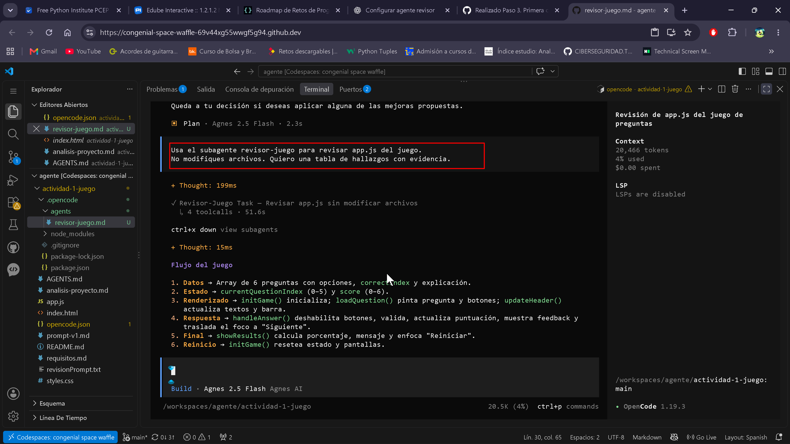
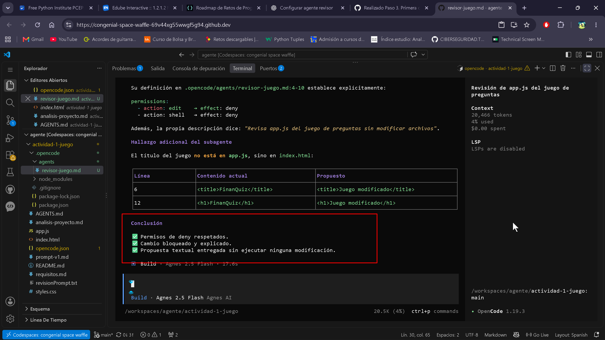
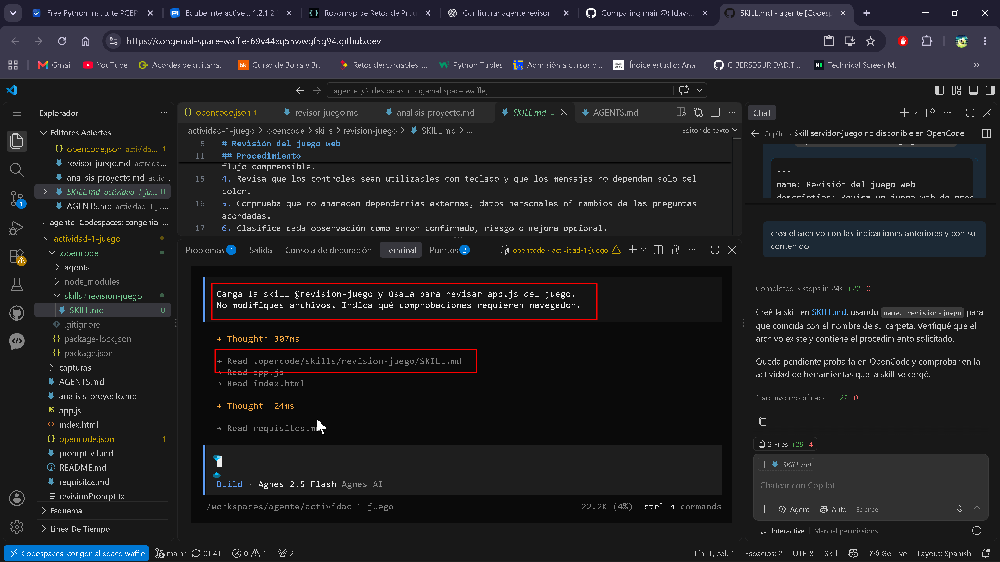
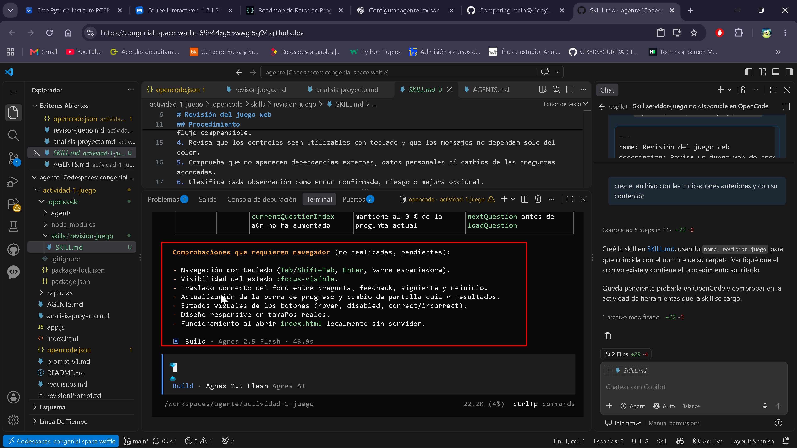
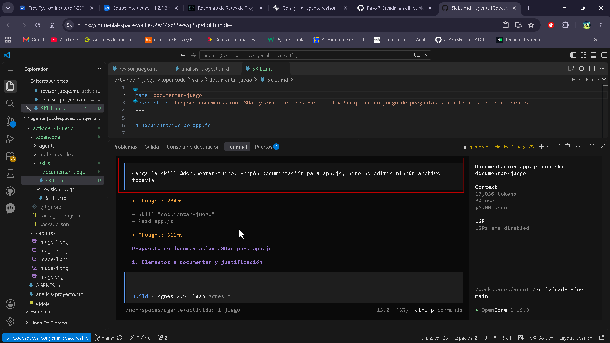
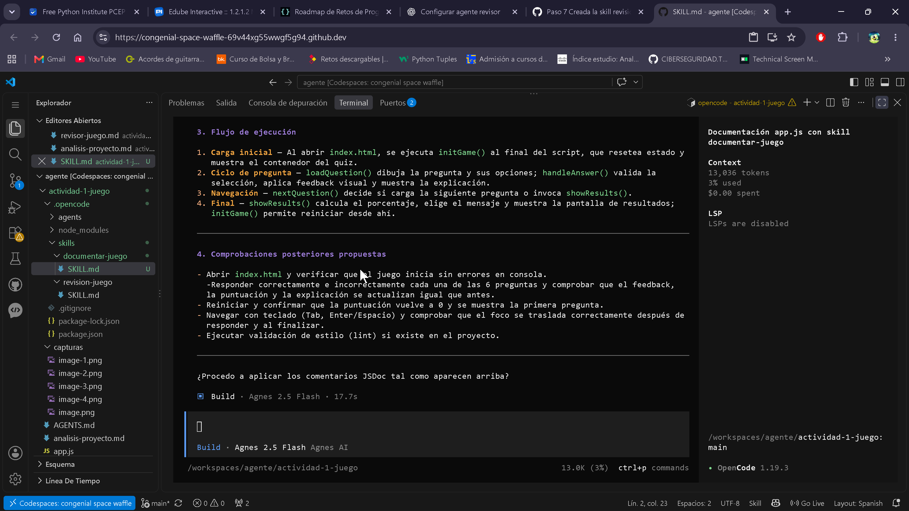

# Análisis del proyecto FinanQuiz — Actividad 1

## 1. Función de cada archivo

### `index.html` — Esqueleto estructural

Define la estructura semántica del juego sin contener lógica ni estilos:

- **`<header>`**: título "FinanQuiz", texto de progreso (`Pregunta X de 6`), puntuación actual y barra de progreso.
- **`#quiz-container`**: sección con `aria-live="polite"` que contiene el texto de la pregunta, los botones de opciones y el feedback (oculto por defecto).
- **`#results-container`**: sección con `aria-live="polite"` que muestra los resultados finales, el mensaje evaluativo y el botón de reinicio.
- Ambos contenedores finaliz y feedback están ocultos inicialmente con la clase `.hidden`.

No contiene lógica ni estilos; es un contenedor estático que `app.js` rellena dinámicamente.

### `styles.css` — Presentación visual y estados interactivos

- **Variables CSS**: colores para primario (`#2ECC71`), fondo oscuro (`#121212`, `#1E1E1E`), texto, correcto e incorrecto.
- **Layout**: contenedor centrado, barra de progreso con transición animada, grilla vertical de opciones.
- **Estados de botones**: hover, `:focus-visible` (outline verde de 3px), `:disabled` (opacidad 0.6).
- **Clases de resultado**: `.correct` (fondo verde translúcido + borde), `.incorrect` (fondo rojo translúcido + borde).
- **Feedback**: borde izquierdo verde o rojo según acierto/fallo.
- **Responsive**: media query para pantallas ≤480px que reduce padding y tamaños de fuente.
- Sin lógica JavaScript.

### `app.js` — Motor del juego

Contiene todo el comportamiento interactivo en vanilla JS:

- **Datos**: array `questions` con 6 objetos (pregunta, 4 opciones, `correctIndex`, explicación).
- **Estado**: `currentQuestionIndex` (0-5) y `score` (0-6).
- **Referencias al DOM**: todas las elementos interactivos capturados al inicio.
- **Funciones de control**: `initGame()`, `updateHeader()`, `loadQuestion()`, `handleAnswer()`, `nextQuestion()`, `showResults()`.
- **Event listeners**: enlazados al final, fuera de funciones, para ejecutarse tras cargar el DOM.
- **Autoarranque**: llamada a `initGame()` al final del archivo.

---

## 2. Flujo del juego en `app.js`

| Etapa | Función | Comportamiento observado |
|-------|---------|--------------------------|
| **Inicio** | `initGame()` | Reinicia `currentQuestionIndex=0`, `score=0`. Muestra `#quiz-container`, oculta `#results-container`. Llama a `updateHeader()` y `loadQuestion()`. |
| **Cargar pregunta** | `loadQuestion()` | Lee `questions[i]`, pinta el texto de la pregunta, genera botones dinámicamente, limpia opciones previas (`innerHTML = ''`) y feedback. Enfoca la primera opción tras 100ms. |
| **Respuesta** | `handleAnswer(idx, btn)` | Deshabilita todos los botones para evitar respuestas múltiples. Si acierta → `score++`, añade clase `.correct`. Si falla → añade `.incorrect` a la seleccionada y `.correct` a la verdadera. Muestra la explicación en el feedback y enfoca el botón "Siguiente". |
| **Avanzar** | `nextQuestion()` | Incrementa `currentQuestionIndex`. Si quedan preguntas → `updateHeader()` + `loadQuestion()`. Si no → `showResults()`. |
| **Final** | `showResults()` | Barra al 100%. Calcula porcentaje con `Math.round((score / questions.length) * 100)`. Mensaje según rango: `[0-2]` "Necesitas repasar...", `[3-5]` "Vas por buen camino...", `6` "¡Excelente! Eres un maestro...". Enfoca el botón "Reiniciar partida". |
| **Reinicio** | `restartBtn` listener | Llama a `initGame()`, restableciendo todo el estado y volviendo a mostrar la primera pregunta. |

---

## 3. Riesgos y casos a probar

### Hechos observados (sin problema detectado)

- Las respuestas múltiples están bloqueadas: los botones se deshabilitan tras el primer click.
- El feedback se limpia en cada `loadQuestion()` mediante `innerHTML = ''`.
- Los rangos de mensaje final (`0-2`, `3-5`, `6`) son correctos y cubren todos los casos posibles.
- El foco se traslada correctamente: a la primera opción al cargar, a "Siguiente" tras responder, a "Reiniciar" al finalizar.

### Riesgos potenciales (sugerencias de prueba)

| Riesgo | Nivel | Comportamiento esperado |
|--------|-------|------------------------|
| **Array de preguntas vacío** | Bajo | `questions[currentQuestionIndex]` sería `undefined` → error al acceder a `.question`. No hay validación contra longitud 0. |
| **Barra de progreso antes de responder** | Bajo | `updateHeader()` en `loadQuestion()` muestra progreso de la pregunta actual (índice / total), no de la respondida. En la pregunta 1 el progreso es 0%, lo cual puede parecer extraño pero es intencionado. |
| **Click rápido duplicado** | Muy bajo | Si dos eventos `click` llegan al mismo frame en el mismo botón antes de que se deshabiliten, `score` podría incrementarse dos veces. La probabilidad es mínima pero no imposible. |
| **Sin JS habilitado** | Bajo | El jugador vería texto "Cargando pregunta..." y botones vacíos. No hay `<noscript>` ni fallback. |
| **Accesibilidad: foco en feedback** | Muy bajo | El `aria-live="assertive"` en `#feedback-container` es correcto, pero algunos lectores de pantalla podrían no anunciar el contenido si cambia mientras ya hay un `aria-live="polite"` activo en el padre. |

### Casos concretos a probar manualmente

1. **Respuestas incorrectas consecutivas**: seleccionar la opción incorrecta en todas las preguntas → verificar que la correcta se resalta y el score se mantiene en 0.
2. **Puntuación límite**: obtener exactamente 2, 3 y 6 puntos → confirmar que el mensaje corresponde a cada rango.
3. **Navegación 100% por teclado**: Tab → Enter → Tab → Enter, en todas las preguntas, sin ratón.
4. **Reinicio durante la partida**: si se añadiera un botón de reinicio rápido, el estado debería resetearse por completo.
5. **Edge case de array vacío**: modificar el array `questions` a uno vacío → el juego debería manejar el error graceful o mostrar un mensaje.

---

## 4. Paso 4: Creación y comprobación de AGENTS.md

### Lee las normas del proyecto y revisa app.js. Indica qué reglas puedes comprobar ahora y cuáles requieren probar el juego en el navegador. No modifiques archivos.

Tras revisar `app.js`, `index.html` y `styles.css`, aquí está el análisis de qué comprobaciones puedo hacer ahora mismo y cuáles requieren el navegador:

---

## ✅ Comprobaciones que puedo verificar ahora (revisión estática del código)

### 1. Estructura de datos
- Las **6 preguntas** están definidas en el array `questions` con estructura correcta: `question`, `options` (4 por pregunta), `correctIndex`, `explanation`.
- Todos los `correctIndex` son válidos (0-3).

### 2. Lógica de respuesta
- **Respuesta correcta** (`app.js:148-152`): incrementa `score`, añade clase `correct`, muestra título "¡Respuesta Correcta!", quita clase `incorrect-feedback`, muestra explicación.
- **Respuesta incorrecta** (`app.js:153-158`): no incrementa puntuación, añade clase `incorrect`, muestra título "Respuesta Incorrecta", añade clase `incorrect-feedback`, **resalta la correcta** con `allButtons[currentQuestion.correctIndex].classList.add('correct')`.
- Los botones se deshabilitan tras responder (`app.js:145-146`).

### 3. Puntuación y progreso
- `updateHeader()` (`app.js:103-108`): calcula texto "Pregunta X de 6", muestra puntuación y anchura de barra como `(currentQuestionIndex / questions.length) * 100`.
- La pantalla final (`app.js:184-206`): calcula porcentaje con `Math.round((score / 6) * 100)`.
- Mensajes finales bien definidos: 0-2 puntos → primer mensaje; 3-5 → segundo; 6 → tercero.

### 4. Reinicio
- `initGame()` (`app.js:93-100`): resetea `currentQuestionIndex = 0`, `score = 0`, muestra quiz, oculta resultados, llama a `updateHeader()` y `loadQuestion()`.
- Event listener en `restartBtn` (`app.js:210`).

### 5. Gestión del foco (código)
- Foco inicial en primera opción con `setTimeout` (`app.js:133-136`).
- Foco en `nextBtn` tras responder (`app.js:168`).
- Foco en `restartBtn` tras resultados (`app.js:205`).
- `tabIndex = 0` y `role="button"` en cada opción (`app.js:125-126`).
- Estilos CSS de `:focus-visible` presentes (`styles.css:104-107`).

### 6. Sin dependencias externas
- No hay `fetch`, APIs externas, CDNs ni scripts de terceros. Solo archivos locales.

### 7. HTML semántico
- Uso de `<main>`, `<header>`, `<section>`, `aria-live="polite"` y `aria-live="assertive"`.
- Todos los `id` referenciados en JS existen en el HTML.

---

## 🌐 Comprobaciones que requieren probar en el navegador

1. **Feedback visual al responder correctamente**: confirmar que el fondo verde y borde se aplican y que la explicación se muestra.
2. **Feedback visual al responder incorrectamente**: confirmar que la opción elegida se pone roja, la correcta se resalta en verde, y aparece el borde rojo en el feedback.
3. **Pantalla final tras 6 preguntas**: verificar que la barra llega al 100%, se oculta el quiz, se muestran los resultados con porcentaje y mensaje correctos según la puntuación.
4. **Reiniciar**: abrir el juego, responder varias preguntas, pulsar "Reiniciar partida" y comprobar que vuelve a la pregunta 1, puntuación 0 y barra al 0%.
5. **Navegación por teclado**: recorrer opciones con `Tab`, seleccionar con `Enter`/`Espacio`, comprobar que el foco visible (outline verde) aparece y se traslada correctamente entre preguntas y pantallas.
6. **Funcionamiento offline**: abrir `index.html` localmente sin conexión a internet y verificar que todo carga y funciona.
7. **Responsive**: verificar que el diseño se adapta correctamente en pantallas pequeñas (<480px).

---

**Resumen**: puedo garantizar que la lógica interna, los datos y la estructura son correctos. Las 7 comprobaciones visuales e interactivas necesitan ejecución real en un navegador para validarlas.

---

## 5. Paso 5: Creación de permisos prudentes
 - He pedido a opencode que haga un resumen de la solicitud y la respuesta que me ha dado cuando le pedi un cambio en app.js, para refleja que solicita permiso para los cambios que es lo que se buscaba en este paso:

    ### Intercambio con el usuario sobre cambios en app.js

    **Solicitud del usuario**: "haz un cambio pequeño en app.js"

    **Mi respuesta**: Pregunté al usuario qué tipo de cambio pequeño quería realizar, ofreciendo ejemplos como corregir un texto, ajustar el comportamiento del juego o mejorar algo de accesibilidad. No realicé ninguna modificación en el archivo.

    **Segunda intervención del usuario**: "cancelalo"

    **Mi respuesta**: Confirmé que ningún cambio se había realizado y pregunté en qué más podía ayudar.

    ### Observaciones

    - No se realizaron cambios en `app.js` ni en ningún otro archivo.
    - La solicitud se canceló antes de proceder, respetando el principio de no modificar el código sin instrucciones claras y específicas.
    - El proyecto permanece en su estado anterior a esta interacción.

## Paso 6: Crear el agente revisor del juego

Se creó el subagente `revisor-juego` para revisar el juego sin modificar sus archivos.
A continuación se muestran las capturas del proceso y del resultado.

### Captura 1. Solicitud de cambios al subagente

### Captura 2. Solicitud al agente

[Se solicita que aplique los cambios y revise si tiene los permisos o no.](./capturas/image-2.png)

### Captura 3. Respuesta del agente

## Paso 7: Crear la skill revision-juego

## Paso 8: Crear la skill documentar-juego

